A vision-language model (VLM) reads both pictures and text. In this lesson you will compute CLIP's contrastive loss by hand, check it in NumPy, use the same encoders for zero-shot classification, and count the tokens a Vision Transformer (ViT) produces from an image.

**You need:** dot products and unit vectors (Lesson 20.1), token embeddings (Lesson 24.1), and softmax attention (Lesson 25.1).

## The problem CLIP solves

A standard image classifier has one output unit per label, fixed before training. ImageNet has 1,000 labels, so a model trained on it cannot name a 1,001st class without new labelled images and retraining. Labels are the expensive part.

CLIP (Contrastive Language–Image Pretraining; Radford et al., 2021) skips the fixed label list. It learns from 400 million (image, text) pairs collected from the internet, where the caption is the supervision. Its pretraining task is to predict which caption goes with which image.

## Two encoders, one shared space

CLIP has two encoders. An image encoder maps an image to a vector, and a text encoder maps a caption to a vector, both in the same space. Each vector is scaled to unit length, so the similarity of an image and a caption is their cosine, which is the dot product of the two unit vectors.

Training pulls matched pairs together and pushes mismatched pairs apart. The batch supplies the mismatches for free.

## The batch is the classifier

Take a batch of $N$ pairs. Compute all $N \times N$ cosine scores. The $N$ diagonal cells are true pairs, and the other $N^2 - N$ cells are negatives that come from the same batch.

 above its own caption (0.80): a hard negative.")

The loss asks two questions. For each image (row), is its true caption the most probable among the $N$ captions? For each caption (column), is its true image the most probable among the $N$ images? CLIP averages both (Radford et al., 2021, Figure 3).

.")

## Worked example by hand

Take $N = 3$ pairs with unit vectors, as in the figure. Use logit scale $s = 10$ so the arithmetic stays simple. Row 0 has logits $s\cdot\cos = [10,\ 0,\ 6]$. Its true caption is index 0, so the probability is

$$
p_{00} = \frac{e^{10}}{e^{10} + e^{0} + e^{6}} = \frac{22026.5}{22430.9} \approx 0.982,
\qquad \ell_0 = -\ln 0.982 \approx 0.018.
$$

Row 1 has logits $[6,\ 8,\ 10]$. Caption 2 beats its true caption 1, so the probability of the true caption is $e^{8} / (e^{6} + e^{8} + e^{10}) \approx 0.117$, and the loss is $\ell_1 \approx 2.143$ nats (the unit when the logarithm is natural). Row 2 gives $\ell_2 \approx 2.127$, so the mean row loss is $(0.018 + 2.143 + 2.127)/3 \approx 1.429$.

Run the same batch in NumPy:

```python
import numpy as np

def l2_normalize(x):
    return x / np.linalg.norm(x, axis=1, keepdims=True)

def softmax(z, axis):
    z = z - z.max(axis=axis, keepdims=True)  # subtract the max for numerical stability
    e = np.exp(z)
    return e / e.sum(axis=axis, keepdims=True)

def clip_loss(img, txt, scale):
    I = l2_normalize(img)                    # unit image vectors, one row per image
    T = l2_normalize(txt)                    # unit caption vectors, one row per caption
    logits = scale * (I @ T.T)               # N x N: logits[i, j] = scale * cos(image i, caption j)
    labels = np.arange(len(img))             # the true caption of image i is caption i
    p_rows = softmax(logits, axis=1)         # image -> text: each row sums to 1
    p_cols = softmax(logits, axis=0)         # text -> image: each column sums to 1
    loss_t = -np.log(p_rows[labels, labels]).mean()
    loss_i = -np.log(p_cols[labels, labels]).mean()
    return (loss_i + loss_t) / 2, loss_t, loss_i, logits, p_rows

img = np.array([[1.0, 0.0], [0.6, 0.8], [0.0, 1.0]])
txt = np.array([[1.0, 0.0], [0.0, 1.0], [0.6, 0.8]])
loss, loss_t, loss_i, logits, p_rows = clip_loss(img, txt, scale=10.0)
print("logits at scale 10:")
print(np.round(logits, 4))
print("image -> text probabilities:")
print(np.round(p_rows, 4))
print("true-caption loss per row:", np.round(-np.log(np.diag(p_rows)), 4))
print("loss_t =", round(loss_t, 4), " loss_i =", round(loss_i, 4), " loss =", round(loss, 4))
```

```output
logits at scale 10:
[[10.  0.  6.]
 [ 6.  8. 10.]
 [ 0. 10.  8.]]
image -> text probabilities:
[[0.982  0.     0.018 ]
 [0.0159 0.1173 0.8668]
 [0.     0.8808 0.1192]]
true-caption loss per row: [0.0182 2.1429 2.127 ]
loss_t = 1.4294  loss_i = 1.4294  loss = 1.4294
```

The two directions agree here only because this batch is symmetric. In general `loss_t` and `loss_i` differ.

> [!KEY-INSIGHT]
> The loss is an $N$-way classification, repeated $N$ times in each direction. The "classes" are the other items in the batch, so the batch size sets how hard the task is. This is the InfoNCE loss, which van den Oord et al. (2018) introduced for contrastive predictive coding. CLIP's paper attributes the name to that work.

## Temperature: how sharp the softmax is

The logits are the scaled cosines $s \cdot \cos$, where $s = 1/\tau$ and $\tau$ is the temperature. CLIP initialises $\tau$ to 0.07, so $s \approx 14.29$. The paper learns $\tau$ as a log-parameterised scalar and clips it so that $s$ never exceeds 100, which it reports as necessary for stable training (Radford et al., 2021, training details).

Change only the scale on the same batch, and watch the probability of image 1's true caption.



At scale 1 the softmax is almost flat: $p = 0.33$ is close to the uniform $1/3$. At scale 100 the loss is 13.33 because a gap of 0.2 in cosine becomes a gap of 20 in logit, so $e^{-20} \approx 2 \times 10^{-9}$ per wrong caption. Rows 1 and 2 each contribute 20 nats, and row 0 contributes about 0, so the mean is $(0 + 20 + 20)/3 \approx 13.3$. A large scale punishes a single confident mistake without limit, which is why the clip matters.

## Zero-shot classification

Now use the trained encoders without any further training. For a set of class names, build one text per class, such as "a photo of a cat", encode each one, and compare the image vector with every prompt vector. The paper describes this as a multinomial logistic regression whose weights are generated by the text encoder, with normalised inputs and weights, no bias, and temperature scaling (Radford et al., 2021, §3.1). Changing the class list changes only the text vectors, so the same model can classify any labels you can write down.

The paper reports 76.2% ImageNet top-1 accuracy for its best model in the Table 1 comparison, which matches a supervised ResNet-50 trained on the 1.28 million labelled ImageNet images (Radford et al., 2021, §3.1.3). The NumPy sketch below uses synthetic toy vectors, not CLIP's weights, so its numbers say nothing about that accuracy.

```python
import numpy as np

prompts = np.array([[1.0, 0.2, 0.0],    # "a photo of a cat"
                    [0.0, 1.0, 0.3],    # "a photo of a dog"
                    [0.2, 0.1, 1.0]])   # "a photo of a car"
prompts = prompts / np.linalg.norm(prompts, axis=1, keepdims=True)
image = np.array([0.9, 0.35, 0.1])
image = image / np.linalg.norm(image)

cos = prompts @ image                    # cosine similarity to each prompt
logits = cos / 0.07                      # temperature 0.07, i.e. logit scale 1/0.07
e = np.exp(logits - logits.max())
probs = e / e.sum()
for name, c, p in zip(["cat", "dog", "car"], cos, probs):
    print(f"{name}: cos={c:.4f}  p={p:.4f}")
print("prediction:", ["cat", "dog", "car"][int(np.argmax(cos))])
```

```output
cat: cos=0.9797  p=0.9997
dog: cos=0.3749  p=0.0002
car: cos=0.3166  p=0.0001
prediction: cat
```



## The vision encoder: images as token sequences

CLIP uses two image encoder families. One is a ResNet-50 with its global average pooling replaced by attention pooling. The other is a Vision Transformer (ViT), which the paper trains as ViT-B/32, ViT-B/16 and ViT-L/14 (Radford et al., 2021, §2.4). The number after the slash is the patch size.

A ViT turns an image into tokens. It cuts the image into square patches, flattens each patch into one vector, applies one linear layer, prepends a learned [CLS] token, and adds learned position embeddings (Dosovitskiy et al., 2020, §3). The output at the [CLS] position, after the Transformer layers, is the image representation. CLIP then applies a linear projection to map it into the shared space (Radford et al., 2021, §2.3).



The counts for a 224 px image with 16 px patches come straight from the arithmetic:

```python
image_px, patch_px, channels = 224, 16, 3
per_side = image_px // patch_px
n_patches = per_side * per_side
patch_values = patch_px * patch_px * channels
print("patches per side:", per_side)
print("patches:", n_patches, "| tokens with [CLS]:", n_patches + 1)
print("values per patch:", patch_values)
d = 768
print("patch projection parameters (weights + bias):", patch_values * d + d)
print("ViT-L/14 at 336 px:", (336 // 14) ** 2, "patches")
```

```output
patches per side: 14
patches: 196 | tokens with [CLS]: 197
values per patch: 768
patch projection parameters (weights + bias): 590592
ViT-L/14 at 336 px: 576 patches
```

The patch projection is the only place where pixels enter the model: $768 \times 768 + 768 = 590{,}592$ parameters for a model of width 768. The rest of the ViT is a standard Transformer over the token sequence.

The number of tokens depends on image resolution. The paper fine-tunes its best model, ViT-L/14@336px, for one extra epoch at 336 px, which gives 576 patches instead of 256 at 224 px. The position embeddings are adjusted at fine-tuning time for the new resolution, which is why resolution changes need care (Dosovitskiy et al., 2020, §3).

## Common traps

> [!TRAP]
> Skipping the normalisation. Without it, a dot product rewards large vector norms rather than alignment, and the "temperature" no longer means the same thing. The formula assumes unit vectors.

> [!TRAP]
> Reading zero-shot accuracy as a property of the model alone. The class names, the prompt wording and the image resolution all change the result, so report them with any number.

> [!TRAP]
> Small batches give few hard negatives. The loss only ever sees the other $N-1$ captions in the batch. CLIP used a batch of 32,768 (Radford et al., 2021, hyperparameter table).

> [!TRAP]
> Treating web captions as clean labels. A caption can describe the wrong thing, or nothing visible, so some pairs are simply wrong. This is my reasoning from how web data is collected, not a result from the paper.

> [!TRAP]
> Ignoring the scale. Changing $s$ from 10 to 100 on the same batch moves the loss from 1.43 to 13.33. The clip on $s$ is part of the method, not a detail.

## Summary

- CLIP trains an image encoder and a text encoder so that matched (image, caption) pairs have high cosine similarity, using a symmetric softmax loss over an $N \times N$ batch.
- The loss is N-way classification repeated in both directions, so the batch size sets the difficulty.
- The temperature (logit scale $1/\tau$) controls how sharply hard negatives are penalised. CLIP starts at $\tau = 0.07$ and clips the scale at 100.
- Zero-shot classification encodes class names as text prompts and picks the highest cosine. Changing the labels needs no retraining.
- A ViT turns a 224 px image into 196 patch tokens of 768 values each, plus one [CLS] token.

## Quiz time

### Question 1: Calculation

Using the worked example at scale 10, what is the loss for image 0 (row 0)? Give the probability of its true caption first.

<details><summary>Show Solution</summary>

The row is $[10, 0, 6]$, so $p_{00} = e^{10} / (e^{10} + e^{0} + e^{6}) \approx 0.982$. The loss is $-\ln 0.982 \approx 0.018$ nats. This matches the output `true-caption loss per row: [0.0182 ...]`.

</details>

### Question 2: Prediction

Keep the same batch but change the scale from 10 to 100. Without running the code, predict whether the mean loss rises or falls, and roughly by how much.

<details><summary>Show Solution</summary>

It rises, to about 13.3. Rows 1 and 2 each have a cosine gap of 0.2 between the true caption and a wrong one. At scale 100 that gap is 20 logits, so each of those rows contributes about 20 nats. Row 0 has a gap of at least 0.4 and contributes almost nothing. The mean is $(0 + 20 + 20)/3 \approx 13.3$, which matches the temperature sweep in the figure.

</details>

### Question 3: Bug spotting

A colleague writes `logits = (img @ txt.T) * 10` on the raw, unnormalised image and text features, then applies the same softmax loss. Name the bug and say what goes wrong.

<details><summary>Show Solution</summary>

The vectors are not normalised, so `img @ txt.T` is a dot product, not a cosine. Its size depends on the norms of the features as well as on their direction. A caption with a large norm can win every row, whatever its content. The fix is to divide each row by its L2 norm before the product, as `l2_normalize` does in the code above.

</details>

### Question 4: Explanation

Why does CLIP compute the loss in both directions (image to text, and text to image) instead of only one?

<details><summary>Show Solution</summary>

The row term asks, for each image, which caption matches it. The column term asks, for each caption, which image it matches. Each direction gives a different classification problem with the same matched pairs on the diagonal. Averaging the two makes the image and text encoders symmetric, so neither modality is treated as the query for the other. The paper describes this as a symmetric cross-entropy (Radford et al., 2021, Figure 3).

</details>

### Question 5: Explanation

A ViT-B/16 sees a 224 px image. Why does its patch projection have 590,592 parameters, and not depend on the number of patches?

<details><summary>Show Solution</summary>

The projection maps each patch, of $16 \times 16 \times 3 = 768$ values, to a 768-dimensional token. That is one shared linear layer, $768 \times 768$ weights plus 768 biases, applied to every patch. The number of patches changes the sequence length, not the weights. The position embeddings do depend on the grid, which is why higher resolutions need them to be extended.

</details>

## References

1. Radford, A. et al. (2021). *Learning Transferable Visual Models From Natural Language Supervision.* arXiv:2103.00020. Opened the abstract and full text: dataset size, Figure 3 pseudocode, temperature initialisation and clip, batch size, and Table 1 zero-shot accuracy.
2. Dosovitskiy, A. et al. (2020). *An Image is Worth 16x16 Words: Transformers for Image Recognition at Scale.* arXiv:2010.11929. Opened the abstract and the full text: patch flattening, the linear projection, the [class] token, and the resolution adjustment of position embeddings (§3).
3. van den Oord, A., Li, Y. and Vinyals, O. (2018). *Representation Learning with Contrastive Predictive Coding.* arXiv:1807.03748. Opened the abstract. The InfoNCE name comes from CLIP's text, which cites this paper.
