By the end of this lesson you will be able to write the forward noising step of a diffusion model, explain why a diffusion transformer (DiT) runs on a compressed latent split into patches, and implement the adaLN-Zero block in NumPy. You will also see exactly what OpenAI has and has not published about Sora.

**You need:** scaled dot-product attention (Lesson 25.1), the transformer block (Lesson 26.1), and the idea of a learned encoder that maps inputs to vectors (Lesson 60.1). Everything runs in NumPy, so no GPU is needed.

## The problem: too many numbers to denoise

A diffusion model learns to generate an image by learning to undo gradual noising. The catch is size. A 512 by 512 RGB image has $512 \times 512 \times 3 = 786{,}432$ numbers, and a denoiser must process all of them at every step. A video multiplies that by the number of frames.

Two design choices shrink the problem. The first is to denoise a compressed latent code produced by an autoencoder, not the pixels. The second is to use a transformer as the denoiser, which reads the latent as a sequence of tokens.



Latent diffusion (Rombach et al., 2022) provides the first step: its models operate in the latent space of pretrained autoencoders. The DiT paper (Peebles and Xie, 2023) introduced the second: it replaces the U-Net backbone of earlier diffusion models with a transformer that operates on latent patches.

## The forward process: noise with a closed form

Write $x_0$ for a clean latent and $\varepsilon$ for standard Gaussian noise (mean 0, variance 1). The forward process adds noise over $T$ steps. Define $\bar\alpha_t = \prod_{s \le t} (1 - \beta_s)$, where $\beta_s$ is a small variance chosen per step. Then the noisy sample at step $t$ can be written in one shot:

$$
x_t = \sqrt{\bar\alpha_t}\, x_0 + \sqrt{1 - \bar\alpha_t}\, \varepsilon
$$

The first term is the surviving signal and the second is the injected noise. Ho et al. (2020) used a linear schedule with $\beta$ rising from $10^{-4}$ to $0.02$ over $T = 1000$ steps.



Worked example by hand. Take $x_0 = 1.0$, $\bar\alpha_t = 0.25$ and $\varepsilon = 0.5$. Then $\sqrt{0.25} = 0.5$ and $\sqrt{0.75} \approx 0.866$, so $x_t = 0.5 \cdot 1.0 + 0.866 \cdot 0.5 \approx 0.933$. The code reproduces this and prints the schedule.

```python
import numpy as np

# Worked example: one scalar with x0 = 1.0, abar = 0.25, eps = 0.5
x0, abar, eps = 1.0, 0.25, 0.5
xt = np.sqrt(abar) * x0 + np.sqrt(1 - abar) * eps
print(f"x_t by hand: {0.5 + np.sqrt(0.75) * 0.5:.4f}")
print(f"x_t in code: {xt:.4f}")

# DDPM linear schedule: T = 1000 steps, beta from 1e-4 to 0.02
T = 1000
betas = np.linspace(1e-4, 0.02, T)
abar_all = np.cumprod(1 - betas)
for t in [0, 250, 500, 750, 999]:
    print(f"t={t:4d}  signal={np.sqrt(abar_all[t]):.3f}  noise={np.sqrt(1 - abar_all[t]):.3f}")
```

```output
x_t by hand: 0.9330
x_t in code: 0.9330
t=   0  signal=1.000  noise=0.010
t= 250  signal=0.722  noise=0.692
t= 500  signal=0.279  noise=0.960
t= 750  signal=0.057  noise=0.998
t= 999  signal=0.006  noise=1.000
```

By $t = 999$ almost no signal is left, so generation starts from pure noise.

## Training: predict the noise

The network $\varepsilon_\theta(x_t, t)$ takes the noisy latent and the timestep and predicts the noise that was added. The simplified DDPM objective is the mean squared error between the true and predicted noise, with $t$ drawn uniformly from $\{1, \dots, T\}$ (Ho et al., 2020, Section 3.4):

$$
L(\theta) = \mathbb{E}_{t,\, x_0,\, \varepsilon} \left[ \left\| \varepsilon - \varepsilon_\theta\!\left(\sqrt{\bar\alpha_t}\, x_0 + \sqrt{1 - \bar\alpha_t}\, \varepsilon,\ t\right) \right\|^2 \right]
$$

Why predict the noise rather than the clean latent? Because the noise prediction turns directly into an estimate of $x_0$. Rearranging the forward equation gives $\hat{x}_0 = (x_t - \sqrt{1 - \bar\alpha_t}\, \hat\varepsilon) / \sqrt{\bar\alpha_t}$. The next block checks this: with the exact noise, the clean vector comes back to machine precision. It also computes the loss of a network that always predicts zero noise. Since $\mathbb{E}[\varepsilon^2] = 1$, that loss is 1, which is the baseline a trained network must beat.

```python
import numpy as np

rng = np.random.default_rng(0)
T = 1000
abar_all = np.cumprod(1 - np.linspace(1e-4, 0.02, T))

x0 = rng.normal(size=8)                 # a clean latent vector
t = 500
eps = rng.normal(size=8)                # the noise the network must predict
xt = np.sqrt(abar_all[t]) * x0 + np.sqrt(1 - abar_all[t]) * eps

# If the network predicted eps exactly, x0 is recovered in closed form
x0_hat = (xt - np.sqrt(1 - abar_all[t]) * eps) / np.sqrt(abar_all[t])
print("exact eps recovers x0:", bool(np.abs(x0_hat - x0).max() < 1e-12))

# Loss of a network that predicts zero noise everywhere: E[eps^2] = 1
E = rng.normal(size=100_000)
print(f"MSE of predicting zero: {np.mean(E ** 2):.2f}")
```

```output
exact eps recovers x0: True
MSE of predicting zero: 1.00
```

Sampling runs the learned reverse process from $x_T$ back to $x_0$. In the ancestral sampler of Ho et al. (2020, Algorithm 2), each step calls the network once, so generating one latent takes $T = 1000$ network evaluations. Fewer-step samplers exist, but this lesson does not cover them.

## Patchify: a latent becomes a token sequence

A transformer needs a sequence of tokens. DiT cuts the latent of shape $I \times I \times C$ into non-overlapping $p \times p$ patches, flattens each patch into one vector of $p \cdot p \cdot C$ numbers, and applies a linear layer to get a token. The number of tokens is

$$
n = \left(\frac{I}{p}\right)^2
$$

For the 512-pixel model, the latent is $64 \times 64 \times 4$. With $p = 2$ the paper's XL/2 model sees 1,024 tokens, each made of $2 \cdot 2 \cdot 4 = 16$ numbers. The DiT paper states that smaller $p$ gives a longer sequence and therefore more compute (Gflops). In the name "DiT-XL/2", the "/2" is the patch size, not a count of layers.



The cost is in attention, which compares every token with every other token. For $n$ tokens the score matrix has $n^2$ entries, so cost grows with the square of the token count. The next block counts tokens and pairs for image and video latents.

```python
def tokens_image(I, p):
    return (I // p) ** 2

def tokens_video(T, H, W, pt, ph, pw):
    return (T // pt) * (H // ph) * (W // pw)

cases = [("image 64x64 latent, p=4", tokens_image(64, 4)),
         ("image 64x64 latent, p=2", tokens_image(64, 2)),
         ("video 4x32x32, (1,2,2)", tokens_video(4, 32, 32, 1, 2, 2)),
         ("video 4x32x32, (2,2,2)", tokens_video(4, 32, 32, 2, 2, 2)),
         ("video 16x32x32, (2,2,2)", tokens_video(16, 32, 32, 2, 2, 2))]
for name, n in cases:
    print(f"{name:26s} tokens={n:5d}  attention pairs={n * n:>9,d}")
```

```output
image 64x64 latent, p=4    tokens=  256  attention pairs=   65,536
image 64x64 latent, p=2    tokens= 1024  attention pairs=1,048,576
video 4x32x32, (1,2,2)     tokens= 1024  attention pairs=1,048,576
video 4x32x32, (2,2,2)     tokens=  512  attention pairs=  262,144
video 16x32x32, (2,2,2)    tokens= 2048  attention pairs=4,194,304
```



## adaLN-Zero: conditioning that starts as the identity

The denoiser must know the timestep $t$ and the class label. DiT produces a conditioning vector $c$ from both, and uses it to modulate each block. Layer normalisation (LN) is made adaptive: a learned shift and scale are predicted from $c$. Each residual branch is also multiplied by a learned gate $\alpha$.

The key detail is initialisation. The DiT paper initialises the modulation MLP so that every $\alpha$ outputs zero. Each block then computes the identity at the start of training, and the residual branches are switched on as the network learns (Peebles and Xie, 2023). This is the source of the name adaLN-Zero.



The code below implements one such block for a single attention head and a ReLU MLP. It is my own NumPy version, not the paper's code. It uses the form $x(1 + \text{scale}) + \text{shift}$, which reduces to the identity when the scale and shift are zero.

```python
import numpy as np

def layer_norm(x, eps=1e-6):
    return (x - x.mean(-1, keepdims=True)) / np.sqrt(x.var(-1, keepdims=True) + eps)

def dit_block(x, c, W):
    """One transformer block with adaLN-Zero. x: (N tokens, D); c: conditioning vector (D,)."""
    D = x.shape[1]
    s1, sc1, g1, s2, sc2, g2 = np.split(c @ W["mod"] + W["mod_b"], 6)   # six modulation vectors
    h = layer_norm(x) * (1 + sc1) + s1                  # adaptive LayerNorm
    q, k, v = h @ W["q"], h @ W["k"], h @ W["v"]
    a = np.exp(q @ k.T / np.sqrt(D))
    a /= a.sum(-1, keepdims=True)                       # softmax over tokens
    x = x + g1 * ((a @ v) @ W["o"])                     # gated residual: attention
    h = layer_norm(x) * (1 + sc2) + s2
    x = x + g2 * (np.maximum(h @ W["m1"], 0) @ W["m2"]) # gated residual: MLP (ReLU)
    return x

rng = np.random.default_rng(1)
N, D = 16, 8
x = rng.normal(size=(N, D))
c = rng.normal(size=D)
W = {k: rng.normal(scale=0.3, size=(D, D)) for k in ["q", "k", "v", "o", "m1", "m2"]}
W["mod_b"] = np.zeros(6 * D)

W["mod"] = np.zeros((D, 6 * D))                         # adaLN-Zero: modulation MLP zero-initialised
print("zero-init block, max |out - x|:", np.abs(dit_block(x, c, W) - x).max())
W["mod"] = rng.normal(scale=0.3, size=(D, 6 * D))       # non-zero gates
print("random block, max |out - x|:", round(float(np.abs(dit_block(x, c, W) - x).max()), 3))
```

```output
zero-init block, max |out - x|: 0.0
random block, max |out - x|: 0.596
```

With zero-initialised gates, the output equals the input exactly. Random gates change the output by up to 0.596 in this toy setting.

## Latent video and what Sora has published

The same recipe extends to video. A video autoencoder compresses the clip in time and space, and the latent is cut into spacetime patches $(p_t, p_h, p_w)$. The token count becomes $(T/p_t)(H/p_h)(W/p_w)$. The block above uses an assumed latent of 4 frames of 32 by 32 positions (for example, 16 frames of 256 by 256 pixels compressed 4 times in time and 8 times in each spatial direction). Here $(1,2,2)$ gives 1,024 tokens, and $(2,2,2)$ halves that to 512. Keeping $(2,2,2)$ and raising the latent to 16 frames gives 2,048 tokens, four times the 512-token case and sixteen times its attention pairs. These shapes are my illustration, not a published setting.

OpenAI's February 2024 technical report, "Video generation models as world simulators," describes Sora with the same ingredients: a diffusion transformer, a learned compression of video into a lower-dimensional latent space, and spacetime patches used as transformer tokens. Varying output size works by arranging randomly initialised patches in a grid of the chosen size (OpenAI, 2024).

The report also says that "model and implementation details are not included." It gives no parameter count, patch size, latent channel count, noise schedule, training objective, dataset, compute budget or quantitative benchmark. The mechanisms in this lesson are the published open recipe, and nothing here should be read as Sora's exact configuration.

## Common traps

> [!TRAP]
> The network predicts the noise $\varepsilon$, not the image. Recovering $x_0$ needs $\bar\alpha_t$ and the timestep, which is why the timestep must be an input.

> [!TRAP]
> The "/2" in DiT-XL/2 is the patch size, not a layer count. Halving $p$ quadruples the token count and multiplies the attention pairs by sixteen.

> [!TRAP]
> Zero-initialising the gates is not the same as zeroing the weights. In the code above, only the modulation MLP is zero-initialised; the scale and shift are zero too, but the attention and MLP weights are random.

> [!TRAP]
> Latent diffusion can be no better than its autoencoder. Reconstruction error in the autoencoder is a floor on sample quality.

> [!TRAP]
> A 48 times compression figure says nothing about quality. Compression speeds up each step; it does not by itself say how faithful the output is.

## Summary

- Diffusion models learn to predict the noise added at each step, using the closed form $x_t = \sqrt{\bar\alpha_t}\,x_0 + \sqrt{1 - \bar\alpha_t}\,\varepsilon$.
- DiT replaces the U-Net with a transformer over latent patches, so the token count is $(I/p)^2$ and attention cost grows with its square.
- adaLN-Zero conditions each block on the timestep and label through adaptive LayerNorm, and its zero-initialised gates make each block start as the identity.
- Video extends the recipe to spacetime patches. OpenAI's Sora report confirms the ingredients but publishes no architecture or numbers, so Sora's configuration cannot be reproduced from it.

## Quiz time

### Question 1: Calculation

Take $x_0 = 2.0$, $\bar\alpha_t = 0.04$ and $\varepsilon = -1.0$. Compute $x_t$.

<details><summary>Show Solution</summary>

$\sqrt{0.04} = 0.2$ and $\sqrt{0.96} \approx 0.980$. So $x_t = 0.2 \cdot 2.0 + 0.980 \cdot (-1.0) = 0.4 - 0.980 = -0.580$.

</details>

### Question 2: Prediction

A DiT sees a $64 \times 64 \times 4$ latent. Compare patch size 2 with patch size 4. How many tokens does each produce, and how many times more attention pairs does patch size 2 need?

<details><summary>Show Solution</summary>

Patch size 2 gives $(64/2)^2 = 1024$ tokens. Patch size 4 gives $(64/4)^2 = 256$ tokens. Attention pairs are $1024^2 = 1{,}048{,}576$ and $256^2 = 65{,}536$, so patch size 2 needs 16 times more attention pairs.

</details>

### Question 3: Explanation

A colleague sets the gate values $\alpha$ to 1 at initialisation instead of 0. Explain what changes at the first training step, and why DiT's initialisation avoids this.

<details><summary>Show Solution</summary>

With $\alpha = 1$, each residual branch adds a randomly initialised attention or MLP output to the stream at step 0, so the block is no longer the identity. The network starts from a noisy, untrained signal in every block. The zero gate makes each block an identity at initialisation, so the network starts from the input and learns the residual branches gradually. This is my reasoning about the design, consistent with the zero-gate initialisation in the DiT paper.

</details>

### Question 4: Bug-spotting

A training loop computes the loss with `eps_pred = model(x_t, t)` and `loss = ((eps_pred - x0) ** 2).mean()`. What is the bug?

<details><summary>Show Solution</summary>

The target should be the noise $\varepsilon$ that was added, not the clean latent $x_0$. The objective is $\|\varepsilon - \varepsilon_\theta(x_t, t)\|^2$. Training against $x_0$ teaches the network a different target and breaks the noise-to-$x_0$ relation used in sampling.

</details>

## References

- Ho, J., Jain, A., Abbeel, P. (2020). Denoising Diffusion Probabilistic Models. arXiv:2006.11239. Sections 3.2, 3.4 and 4 (schedule, loss, $T = 1000$).
- Peebles, W., Xie, S. (2023). Scalable Diffusion Models with Transformers. arXiv:2212.09748 (ICCV 2023). Patchify, token count, Gflops scaling and adaLN-Zero initialisation.
- Rombach, R., Blattmann, A., Lorenz, D., Esser, P., Ommer, B. (2022). High-Resolution Image Synthesis with Latent Diffusion Models. arXiv:2112.10752 (CVPR 2022 per the arXiv comment field).
- OpenAI (2024). Video generation models as world simulators. Technical report, openai.com/index/video-generation-models-as-world-simulators (February 2024).
